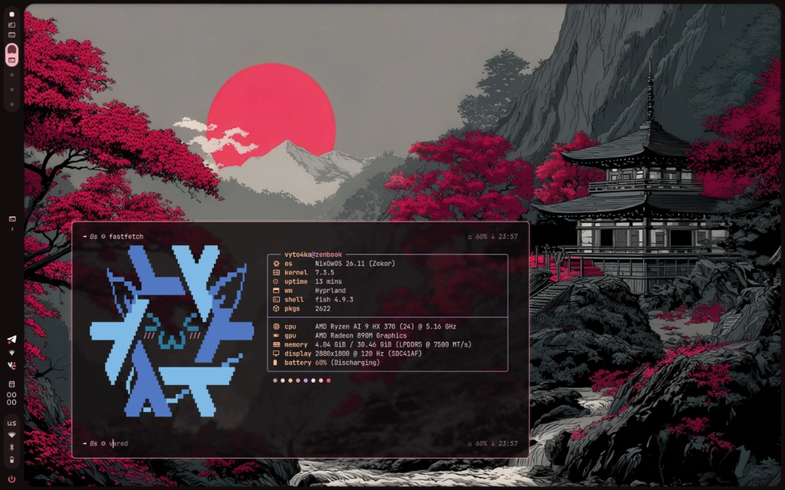

# NixOS для Zenbook



Личный конфиг NixOS (`nixos-unstable`, NixOwOS) для ASUS Zenbook (AMD Ryzen AI 9 HX 370, OLED 2880x1800) с Hyprland, оболочкой Caelestia и всем нужным для повседневной работы.

## Что внутри

- **Окружение:** Hyprland (UWSM, Lua), Caelestia (`caelestia-shell`, `caelestia-cli`, `caelestia-dots`), экран входа SilentSDDM (`catppuccin-mocha`) и запасная сессия KDE Plasma 6.
- **Терминал и шелл:** `foot`, `fish` (`starship`, `zoxide`, `eza`, `direnv`, `forgit`, `fastfetch` с логотипом NixOwOS), `neovim`, `lazygit`, `btop`.
- **Приложения:** Google Chrome (с декларативными расширениями), Zen Browser, VSCodium, vysh, AyuGram, Vesktop (нативный Wayland с PipeWire-захватом экрана), Bitwarden, Obsidian, OnlyOffice, LibreOffice, Okular, Thunderbird, qimgv, VLC, Thunar.
- **Ноутбук и мониторы:** `asusd` с лимитом заряда 80%, `power-profiles-daemon`, фикс OLED Panel Replay (`amdgpu.dcdebugmask=0x400`), демон `hyprdynamicmonitors` с профилями для внешнего дока и режима Clamshell.
- **Сеть и VPN:** Keqdroid (TUN через `polkit` и `hyprpolkitagent`) и Cisco AnyConnect (`networkmanager-openconnect` с WebKitGTK SSO). Оба туннеля работают одновременно (`checkReversePath = "loose"` + `systemd-resolved`).
- **Живые конфиги:** файлы из `config/` и `home/caelestia/` подключаются в `~/.config/` живыми симлинками (`mkOutOfStoreSymlink`). Правки уже отслеживаемых файлов применяются сразу без пересборки, для новых файлов достаточно `git add` и `nrs`.

## Установка на чистую NixOS

Требования: установленная базовая консольная NixOS с активным загрузчиком GRUB, интернетом и пользователем `vyto4ka` с заданным паролем.

```bash
nix-shell -p git --run "git clone https://github.com/vyto4ka/nix ~/nixos-config && cd ~/nixos-config && ./install.sh"
sudo reboot
```

Репозиторий должен лежать строго в `~/nixos-config`: на этот путь указывают живые симлинки Caelestia и `config/`. Скрипт `install.sh` сам скопирует `/etc/nixos/hardware-configuration.nix`, считает параметры GRUB и `system.stateVersion` из текущей системы и соберёт поколение `.#zenbook` через `nixos-rebuild boot` без обрыва сессии.

Полезно после или до установки:

- **Dual-boot с Windows:** сохранить ключ BitLocker и отключить Fast Startup в Windows. Шрифты из `C:\Windows\Fonts` можно перенести в `~/.local/share/fonts/` и обновить кэш через `fc-cache -fv` (подхватываются системно и в OnlyOffice).
- **Внешние мониторы по EDID:** при подключённом USB-C доке запустить `hyprdynamicmonitors tui --enable-lid-events`, чтобы зафиксировать порядок экранов независимо от плавающих имён `DP-*`.
- **Cisco AnyConnect с SSO:** в настройках соединения указать `User Agent: AnyConnect`.

## Алиасы и утилиты в `fish`

| Команда | Что делает |
| :--- | :--- |
| `nrs` | Применить локальные правки сейчас (`nh os switch ~/nixos-config --hostname zenbook`) |
| `nrb` | Собрать поколение на следующую загрузку (`nh os boot ~/nixos-config --hostname zenbook`) |
| `nru` | Обновить все инпуты флейка и пересобрать систему (`scripts/update.sh`) |
| `nrc` | Синхронно обновить только `caelestia-shell` и `caelestia-dots` (`scripts/update.sh --caelestia`) |
| `blur [on\|off\|reset\|<size> [passes]]` | Переключить или подстроить блюр Hyprland на лету (без аргументов инвертирует состояние) |
| `eco [on\|60\|off]` | Энергосбережение: `on` гасит блюр/тени и включает `power-saver`, `60` дополнительно ставит `eDP-1` на 60 Гц, `off` возвращает `balanced` и сбрасывает конфиг Hyprland |
| `, <cmd>` | Разовый запуск любого пакета из `nixpkgs` без установки (`nix-index-database` / `comma`) |

## Основные сочетания клавиш

| Сочетание | Действие |
| :--- | :--- |
| `SUPER` | Лаунчер приложений Caelestia |
| `Win + Пробел` | Переключение раскладки `us,ru` |
| `SUPER + A` | Спецворкспейс AyuGram (`special:ayugram`) |
| `SUPER + D` | Спецворкспейс Vesktop (`special:communication`) |
| `SUPER + T` / `W` / `C` / `E` | Терминал `foot` / Google Chrome / VSCodium / Thunar |
| `SUPER + SHIFT + Q` | Скриншот области с фризом экрана в буфер обмена (`hyprshot`) |
| `SUPER + SHIFT + B` | Включить или выключить блюр Hyprland |
| `SUPER + L` | Блокировка экрана Caelestia |
